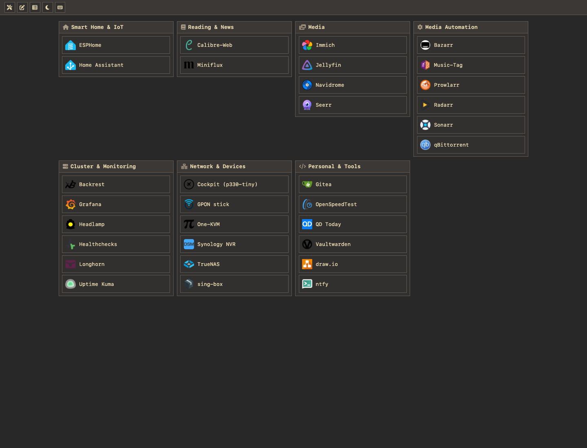
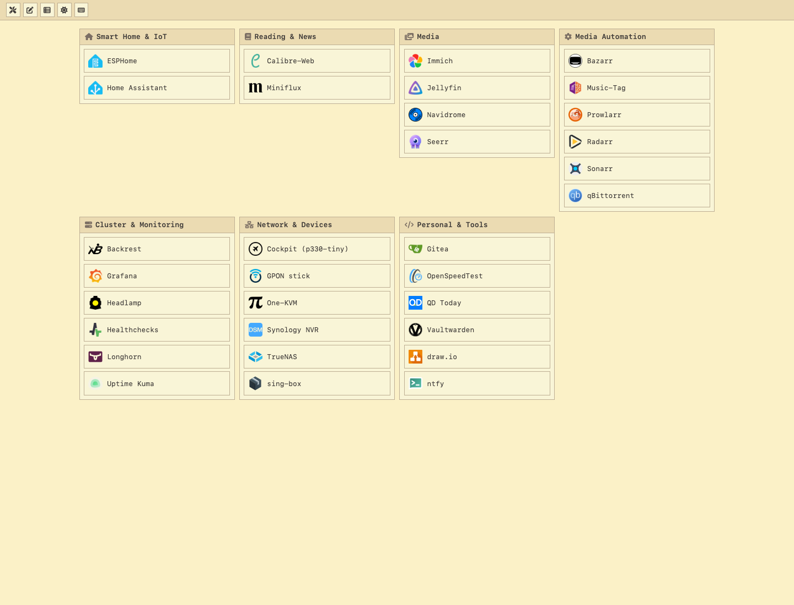
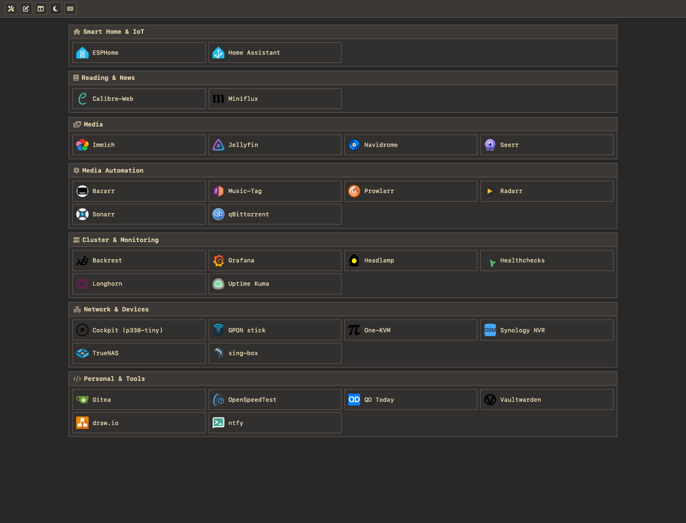

# Homelab

[](https://hub.docker.com/r/zouzonghua/homelab-dashboard)
[](https://github.com/zouzonghua/homelab-dashboard/releases)
[](LICENSE)

[English](README.md) | 简体中文

一个紧凑的自托管服务导航面板，使用 React、Base UI、Go API 和 SQLite。

## 界面预览

Gruvbox 深色 · 纵向布局



Gruvbox 浅色 · 纵向布局



Gruvbox 深色 · 横向布局



## 功能

- Gruvbox 深色、浅色和跟随系统主题；紧凑控件与固定工具栏。
- 宽度达到 640px 时支持横向、纵向布局；手机保持单列，并记住用户原来的布局选择。
- 编辑服务和分组、拖拽排序、JSON 导入导出、操作记录。
- 支持键盘导航和操作。按 **`?`** 查看帮助，**`Esc`** 关闭弹窗，**`Ctrl/⌘ + Enter`** 保存表单。
- 实时健康状态与自动获取服务图标。
- 支持 PWA 安装、本地图标和独立窗口；通过 HTTPS 或 localhost 访问后，可从浏览器菜单安装。

交互控件使用无样式的 [Base UI](https://base-ui.com/react/overview/quick-start)，配合基础 CSS。Dnd Kit 用于排序，Font Awesome 提供分组和工具栏图标。

## 本地开发

使用 Node.js 24、Go 1.26.10 或更高版本。

```bash
git clone https://github.com/zouzonghua/homelab-dashboard.git
cd homelab-dashboard
npm ci --prefix web
make dev
```

打开 `http://localhost:5173`。Vite 会将 `/api` 请求代理到 `http://127.0.0.1:8080` 的 Go 服务。

本地运行生产构建：

```bash
npm --prefix web run build
go run ./cmd/server
```

打开 `http://localhost:8080`。

## Docker

```bash
docker compose -f deploy/compose.yml up -d --build
```

通过 `8080` 端口访问。Compose 将 SQLite 数据库和图标缓存持久化到仓库的 `data/` 目录。已发布镜像为 `zouzonghua/homelab-dashboard:latest`。

应用没有内置用户账号。多人或公网访问时，应通过 Authentik 等认证反向代理保护入口。

## 数据与配置

默认 JSON 位于 [`internal/config/default-dashboard.json`](internal/config/default-dashboard.json)，基于 2026-10-26 的 Authentik 快照整理，包含 **7 个分组、32 个入口**。分组顺序由数组决定，已移除编号和面板自身的快捷方式。

空数据库首次使用时导入默认 JSON；修改默认文件**不会覆盖已有数据库**。需要替换已保存的数据时，先导出备份，再通过 **Config tools → Import config** 导入。后续 Authentik 变更不会自动同步。

| 环境变量 | 默认值 |
| --- | --- |
| `PORT` | `8080` |
| `HOMELAB_DB_PATH` | `data/homelab.db` |
| `HOMELAB_STATIC_DIR` | `web/dist` |
| `HOMELAB_SEED_PATH` | 内嵌默认 JSON；可指定其他文件路径 |

API 文档入口为 `/api/docs`，契约位于 [`api/openapi.yaml`](api/openapi.yaml)，资源接口使用 `/api/v1/`。

## 验证与贡献

```bash
npm --prefix web run api:types:check
npm --prefix web test
npm --prefix web run typecheck
npm --prefix web run build
npm --prefix web run test:e2e
go test ./api ./cmd/... ./internal/...
npm --prefix web audit
```

E2E 测试使用独立数据库和固定样例，不会修改本地面板数据。

开发采用 [main-only + GitHub Flow](CONTRIBUTING.md)：从 `main` 创建短期分支，PR 直接合入 `main`，CI 通过后 Squash。合入 `main` 会发布 Docker 镜像，版本标签会额外发布对应版本镜像。

## 许可证

[MIT](LICENSE) © zouzonghua
